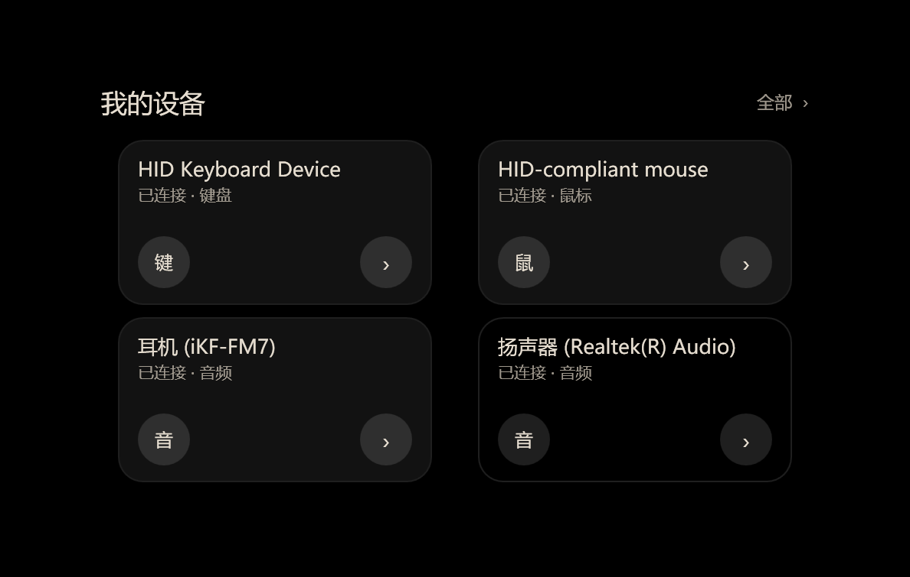

# 此刻 · 设备管理（DeviceWidget）

> 卡片式设备面板：只列当前已连接的键盘 / 鼠标 / 耳机 / 扬声器，点卡片直达系统设置。

与另外三个组件同一套视觉语言：透明浮层、米白细体、右键菜单。



<sub>黑色部分是透明区域，实际会浮在壁纸上。</sub>

## 特性

- **只显示已连接设备**：键盘、鼠标、音频（耳机/扬声器），已去重、过滤虚拟/服务/内置占位项。
- **3 × 2 卡片排布**：横向三列两行，像手机设备页那样平铺。
- **卡片信息**：名称、连接状态（系统暴露电量时显示「电量 xx%」）、类型徽标、进入按钮。
- **点卡片**：键盘/鼠标 → 系统设备页；音频 → 声音设置；右上「全部 ›」→ 蓝牙设置。
- **四种主题**：透明 / 深色玻璃 / 浅色玻璃。
- 四档尺寸、四档不透明度；可置于底层、开机自启；不占任务栏、不进 Alt+Tab。

## 使用

双击 **`启动设备.bat`**。

| 操作 | 效果 |
| --- | --- |
| 点卡片 | 打开对应系统设置 |
| 拖动 | 移动位置（自动记住） |
| 滚轮 | 调整不透明度 |
| 右键 | 刷新 / 蓝牙设置 / 网络设置 / 主题 / 尺寸 / 透明度 / 置于底层 / 开机自启 / 复位 / 退出 |

## 说明：电量

Windows 只对部分蓝牙外设暴露电量（`DEVPKEY_Bluetooth_Battery`）。华为耳机的左右耳/电池盒电量走华为自有协议，系统层拿不到，所以：
- 系统有数据 → 卡片显示「电量 xx%」
- 系统没有 → 只显示连接状态

## 文件

```
device-widget/
├─ DeviceWidget.ps1      # 主程序
├─ 启动设备.bat           # 双击启动
├─ preview.png           # 效果预览
├─ README.md
└─ device.log            # 出错日志（正常为空）
```

## License

MIT
